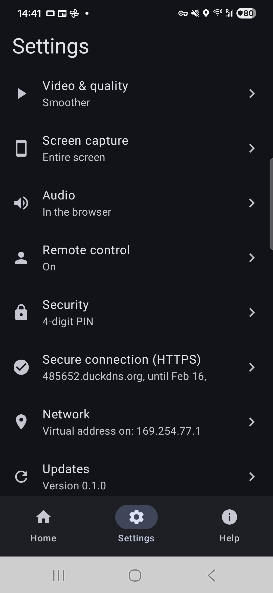
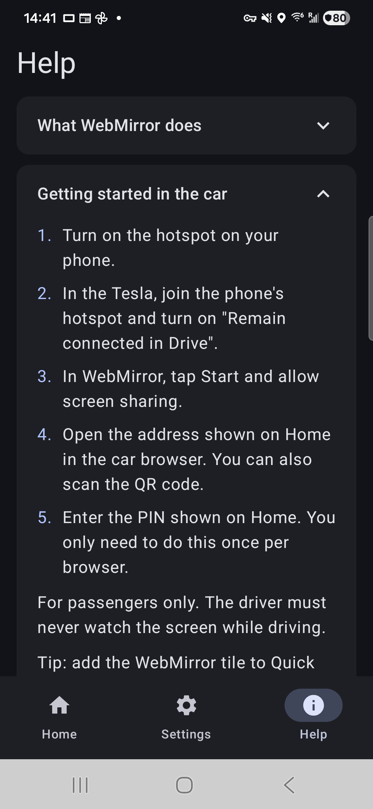
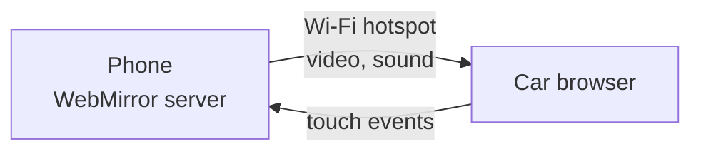

# WebMirror

Mirror your Android phone's screen to the browser in your car, with no app on the car side.

[](https://github.com/danyk20/WebMirror/actions/workflows/ci.yml)
[](https://github.com/danyk20/WebMirror/releases/latest)
[](LICENSE)


<p align="center">
  
  
  
</p>

WebMirror turns your phone into a small web server. The car (or any device) joins the phone's hotspot and opens a web address. The phone's screen appears in the browser. It was built for the Tesla browser but works in any modern browser.

## Features

- **Nothing to install in the car.** Open a web address or scan a QR code.
- **Low delay.** About 40 ms picture delay in measurements, with optional in-sync sound.
- **Automatic codec choice.** H.264, HEVC, VP9 or AV1 through WebCodecs, whichever the phone and the browser both handle in hardware. JPEG fallback on plain `http`.
- **Sound in the browser** (Opus or PCM), or over Bluetooth with a delay slider.
- **Remote touch control from the car**, including multi-touch gestures such as pinch.
- **Pairing PIN** (4 or 6 digits, or off) so others on the hotspot cannot watch or control the phone.
- **Free HTTPS certificate set up on the phone** with DuckDNS and Let's Encrypt, renewed automatically.
- **Virtual address `169.254.77.1`** that the Tesla browser accepts.
- **Quick Settings tile** to start and stop mirroring.
- **In-app updates** in the GitHub version.

## Requirements

- Android 10 (API 29) or newer.
- A phone that can share a Wi-Fi hotspot.
- A browser on the other side. For smooth video it needs WebCodecs, which requires HTTPS. The Tesla MCU2 and MCU3 browsers work.
- For the car: a way to join the hotspot. In a Tesla, turn on "Remain connected in Drive".

## Download and install

1. Download the APK from the [latest release](https://github.com/danyk20/WebMirror/releases/latest).
2. Open it on the phone. Android asks you to allow installs from the browser or file manager you used. Allow it for that app only.
3. Open WebMirror and follow the setup checklist on Home.

Google Play is planned.

### Verify the APK

Releases are signed with one key. Check the certificate before you install:

```bash
apksigner verify --print-certs WebMirror-<version>.apk   # e.g. WebMirror-0.1.0.apk
```

The SHA-256 digest must be:

```
AB:A6:0D:E0:83:91:E4:0E:F4:C4:1E:B6:EE:63:0D:4A:C5:8F:39:DD:6D:BE:D4:3F:44:69:0E:BD:4C:81:EB:6A
```

`apksigner` is part of the Android SDK build tools.

## Quick start

1. Turn on the hotspot on your phone.
2. In the car, join the hotspot. In a Tesla, also turn on **Remain connected in Drive**.
3. In WebMirror, tap **Start** and allow screen sharing.
4. In the car browser, open the address shown on Home, or scan the QR code.
5. Enter the PIN shown on Home. You do this once per browser.
6. Optional but recommended: get a free secure address for smooth video. Follow [docs/HTTPS-CERTIFICATE.md](docs/HTTPS-CERTIFICATE.md). The app guides you in about two minutes.
7. Optional: choose sound under **Settings > Audio**, and switch on **Allow control from the car** on Home.

The in-app **Help** page covers every setting and common problems.

## How it works

The phone captures its screen with Android's screen capture, encodes it with a hardware video encoder and serves it over HTTP or HTTPS with WebSockets. The browser page decodes the video with WebCodecs and draws it. A virtual address on the phone lets the car reach it even though browsers in the car refuse ordinary local addresses. Sound is captured on the phone and played by the page, which keeps picture and sound in sync. Touches from the car go back over the same connection and are injected through an accessibility service.



The wire protocol and architecture are described in [docs/development/PLAN.md](docs/development/PLAN.md).

## Performance

Delay from the phone screen to the browser picture, on a clean Wi-Fi link:

| Mode | Delay |
| --- | --- |
| Picture only | about 40 ms |
| With browser sound, Fast profile | about 140 ms |
| With browser sound, High quality profile | about 190 ms |

Measured with the app's built-in automatic test on a Samsung Galaxy S22, at a desk and in a car. Sound adds delay because the picture waits for the sound to stay in sync. Details: [car test results](docs/development/car-test-results.md).

## Privacy and security

- No accounts, no analytics, no advertising. The app author receives no data.
- Mirroring stays on your local network. The network is used for nothing else, except:
  - DuckDNS, Let's Encrypt and Cloudflare DNS, only while you get or renew a certificate.
  - The GitHub API, only in the GitHub version, to check for updates.
- A PIN pairs each browser. Without a PIN, anyone on your hotspot can watch and control the phone.
- Remote control uses an accessibility service that only injects the touches sent from the car. It does not read your screen. You can turn it off in the app or in Android settings.

See [PRIVACY.md](PRIVACY.md) and [SECURITY.md](SECURITY.md).

## Safety notice

WebMirror is for passengers. The driver must never watch or operate the mirrored screen while driving. Follow the traffic laws of your country.

## Building from source

Prerequisites: JDK 17 and the Android SDK (platform 37). Android Studio provides both.

```bash
./gradlew assembleGithubDebug     # build the GitHub flavor
./gradlew installGithubDebug      # install on a connected phone
./gradlew testDebugUnitTest       # JVM unit tests
for f in app/src/test/js/*.test.js; do node "$f"; done   # web page tests
```

Two product flavors exist: `github` (self-updating, APK in Releases) and `play` (no self-update code, for Google Play).

Release builds are signed only when a key is configured. Use either environment variables (CI) or Gradle properties (for example in `~/.gradle/gradle.properties`):

| Environment variable | Gradle property |
| --- | --- |
| `SIGNING_KEYSTORE_FILE` | `WEBMIRROR_RELEASE_STORE_FILE` |
| `SIGNING_STORE_PASSWORD` | `WEBMIRROR_RELEASE_STORE_PASSWORD` |
| `SIGNING_KEY_ALIAS` | `WEBMIRROR_RELEASE_KEY_ALIAS` |
| `SIGNING_KEY_PASSWORD` | `WEBMIRROR_RELEASE_KEY_PASSWORD` |

Never commit keystores or passwords.

### Project structure

```
app/src/main/java/app/webmirror/android/
  capture/   screen capture and sizing
  encode/    video encoders (H.264, HEVC, VP9, AV1) and JPEG
  audio/     playback capture for browser sound
  stream/    packets, codec choice, bitrate control, clock sync, pairing
  server/    HTTP/HTTPS/WebSocket server and client sessions
  net/       addresses, virtual address, TLS, ACME and DuckDNS
  input/     remote control: accessibility service and gesture engine
  ui/        Jetpack Compose screens
  tile/      Quick Settings tile
  update/    update checker (GitHub flavor)
  test/      automatic test and test pattern
app/src/main/assets/web/   the browser page (plain JavaScript, no build step)
app/src/test/              JVM tests (java/) and web page tests (js/)
```

## Documentation

- [Free HTTPS certificate guide](docs/HTTPS-CERTIFICATE.md)
- [Architecture and protocol](docs/development/PLAN.md)
- [Measured results](docs/development/car-test-results.md)
- [Changelog](CHANGELOG.md)

## Contributing

Contributions are welcome. Read [CONTRIBUTING.md](CONTRIBUTING.md) first. This project follows the [Code of Conduct](CODE_OF_CONDUCT.md).

## License

[MIT](LICENSE) © 2026 Daniel Košč

## Disclaimer

Not affiliated with or endorsed by Tesla, Inc. Tesla is a trademark of Tesla, Inc.
