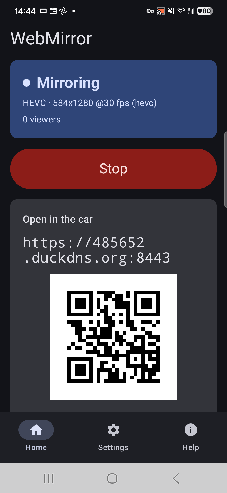
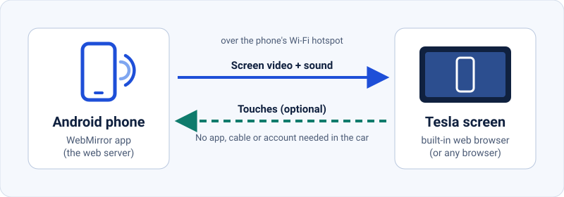

<p align="center"></p>

<h1 align="center">WebMirror</h1>

<p align="center"><b>Mirror your Android phone screen to your Tesla.</b><br>Wireless screen sharing from Android to any web browser, optimised for the Tesla in-car browser. No app, cable or account needed in the car.<br><b>No registration. No tracking. Your data never leaves your devices.</b></p>

<p align="center"><a href="https://danyk20.github.io/WebMirror/"><b>Website</b></a> · <a href="https://github.com/danyk20/WebMirror/releases/latest"><b>Download</b></a> · <a href="https://danyk20.github.io/WebMirror/setup/"><b>Setup guide</b></a> · <a href="https://danyk20.github.io/WebMirror/faq/"><b>FAQ</b></a></p>

[](https://github.com/danyk20/WebMirror/actions/workflows/ci.yml)
[](https://github.com/danyk20/WebMirror/releases/latest)
[](LICENSE)


<p align="center">
  
  
  
</p>

WebMirror shares your Android phone's screen, with sound, to any web browser over Wi-Fi. It is optimised for the **Tesla browser**, so passengers can watch and control the phone on the Tesla touchscreen: videos, navigation apps, photos or anything else on the phone.

How it works in one sentence: the phone turns on its Wi-Fi hotspot, the Tesla joins it, and the Tesla browser opens the address shown in the app. It also works with any other device with a modern browser, such as a laptop, tablet or TV.

## Private by design

> **Your data is yours. It stays on your device.**
>
> WebMirror does not collect, store or share any data about you: not for analytics, not for advertising, not for anything else. There is no registration, no sign-in, no email address and no tracking. There is no WebMirror server: your screen and sound travel directly from your phone to the browser you pair, over your own hotspot, and nowhere else.

| | |
| --- | --- |
| **No registration** | No account, no email, no phone number. Install and use. |
| **No data collection** | No analytics, no crash reporting, no advertising IDs, no tracking SDKs. The developer receives nothing. |
| **Stays on your device** | Settings, paired browsers and certificate keys are kept only on the phone, with secrets encrypted in the Android Keystore. Cloud backup is switched off. |
| **Local connection only** | Mirroring runs over your phone's own Wi-Fi hotspot. No cloud relay, no recording. |
| **Open source** | Every line is public under the MIT license, so anyone can check these promises. |

Details are in the [privacy policy](PRIVACY.md).

## Features

- **Private by design.** No registration and no data collection. Everything stays on your device.
- **Nothing to install in the car.** Open a web address or scan a QR code.
- **Low delay.** About 40 ms picture delay in measurements, with optional in-sync sound.
- **Up to 60 fps.** The default "Smoothest" setting sends 60 fps and falls back to 30 fps by itself if the car cannot keep up.
- **Heat protection.** If the phone gets hot, WebMirror lowers the frame rate and quality by itself and restores them when it cools down.
- **Automatic codec choice.** H.264, HEVC, VP9 or AV1 through WebCodecs, whichever the phone and the browser both handle in hardware. JPEG fallback on plain `http`.
- **Sound in the browser** (Opus or PCM), or over Bluetooth with a delay slider.
- **Remote touch control from the car**, including multi-touch gestures such as pinch.
- **Typing from the car**, with the phone's keyboard in the picture or, on Android 13 or newer, the Tesla browser's own keyboard.
- **Rotate from the car.** A Rotate button turns the phone between portrait and landscape, for a phone in a charging compartment.
- **Pairing PIN** (4 or 6 digits, or off) so others on the hotspot cannot watch or control the phone.
- **Free HTTPS certificate set up on the phone** with DuckDNS and Let's Encrypt, renewed automatically.
- **Virtual address `169.254.77.1`** that the Tesla browser accepts.
- **Quick Settings tile** to start and stop mirroring.
- **In-app updates** in the GitHub version.

## Requirements

- Android 10 (API 29) or newer.
- A phone that can share a Wi-Fi hotspot.
- A browser on the other side. For smooth video it needs WebCodecs, which requires HTTPS. The Tesla MCU2 and MCU3 browsers work.
- For the car: a way to join the hotspot. In a Tesla, turn on "Remain connected in Drive".

## Download and install

1. Download the APK from the [latest release](https://github.com/danyk20/WebMirror/releases/latest).
2. Open it on the phone. Android asks you to allow installs from the browser or file manager you used. Allow it for that app only.
3. Open WebMirror and follow the setup checklist on Home.

Google Play is planned.

### Verify the APK

Releases are signed with one key. Check the certificate before you install:

```bash
apksigner verify --print-certs WebMirror-<version>.apk   # e.g. WebMirror-0.1.0.apk
```

The SHA-256 digest must be:

```
AB:A6:0D:E0:83:91:E4:0E:F4:C4:1E:B6:EE:63:0D:4A:C5:8F:39:DD:6D:BE:D4:3F:44:69:0E:BD:4C:81:EB:6A
```

`apksigner` is part of the Android SDK build tools.

## Quick start

1. Turn on the hotspot on your phone.
2. In the car, join the hotspot. In a Tesla, also turn on **Remain connected in Drive**.
3. In WebMirror, tap **Start** and allow screen sharing.
4. In the car browser, open the address shown on Home, or scan the QR code.
5. Enter the PIN shown on Home. You do this once per browser.
6. Optional but recommended: get a free secure address for smooth video. Follow [docs/HTTPS-CERTIFICATE.md](docs/HTTPS-CERTIFICATE.md). The app guides you in about two minutes.
7. Optional: choose sound under **Settings > Audio**, and switch on **Allow control from the car** on Home.

The in-app **Help** page covers every setting and common problems.

## How it works

The phone captures its screen with Android's screen capture, encodes it with a hardware video encoder and serves it over HTTP or HTTPS with WebSockets. The browser page decodes the video with WebCodecs and draws it. A virtual address on the phone lets the car reach it even though browsers in the car refuse ordinary local addresses. Sound is captured on the phone and played by the page, which keeps picture and sound in sync. Touches from the car go back over the same connection and are injected through an accessibility service.

<p align="center"></p>

### Where your data goes, step by step

1. **The phone creates a private network.** Your phone's own Wi-Fi hotspot connects the phone and the car. This network belongs to you and only devices you let in can join it.
2. **The phone becomes a small web server.** WebMirror runs a tiny server inside the app, on the phone itself. It is reachable only on your hotspot, not from the internet.
3. **The car browser asks to watch and must prove it may.** It enters the PIN shown on the phone. The phone then gives that browser a random pairing key, so you enter the PIN only once per browser.
4. **The picture and sound go straight from phone to car.** They are encoded on the phone and sent over the hotspot to the paired browser. They do not pass through any server, cloud or third party, and nothing is recorded.
5. **When you tap Stop, it is over.** Screen capture ends, the server stops and nothing is left behind except your settings on the phone.

### Why it is safe

- **No server to hack, no database to leak.** WebMirror has no backend and no user accounts, so there is no central store of user data that could be breached, sold or handed over. It does not exist.
- **Only paired browsers can watch.** Without the PIN a browser sees nothing. Pairing keys are long random values from a cryptographic random generator and are checked in constant time.
- **Guessing the PIN does not work.** After 5 wrong PINs within a minute, all PIN entry is locked for a minute. You can change the PIN or unpair all browsers at any moment with "Forget paired viewers".
- **Encrypted connection.** With the free secure address the picture, sound and touches are encrypted with HTTPS (a real Let's Encrypt certificate), so other devices on the network cannot read them.
- **Android stays in control.** Android asks your permission each time screen sharing starts and shows that it is running. You can stop it from the notification, the Quick Settings tile or the app.
- **Remote control is opt-in and blind.** Control from the car is off until you switch it on. The accessibility service only injects the touches sent by a paired browser. It is configured so that it cannot read the content of your screen.
- **Secrets are protected on the phone.** Certificate keys and the DuckDNS token are encrypted with a key held in the Android Keystore, and the app is excluded from cloud backup.
- **Signed releases.** Every release is signed with one key whose fingerprint is published in [Verify the APK](#verify-the-apk). Android installs an update only if it is signed with the same key.
- **Open source.** All code is public, so anyone can verify every point on this list.

The wire protocol and architecture are described in [docs/development/PLAN.md](docs/development/PLAN.md).

## How WebMirror compares

Other ways to get a phone onto a Tesla screen are hardware boxes that plug into the car, and mirroring apps from app stores. How they usually differ:

| | **WebMirror** | Hardware boxes | Other mirroring apps |
| --- | --- | --- | --- |
| Price | **Free** | Paid device, can cost hundreds of euros | Often paid upgrades or ads |
| Extra hardware | **None** | A box plugged into the car | None |
| Registration or email | **None** | Sometimes | Sometimes |
| Data collection | **None, verifiable in public code** | Trust the seller | Trust the store label |
| Cloud or relay server | **None, phone to car directly** | Varies | Some use one |
| Open source | **Yes, MIT** | Some | Rarely |
| Sound in sync in the car | **Yes** | Usually | Not always |
| Touch and typing from the car | **Yes** | Usually | Not always |
| Encrypted HTTPS link | **Free certificate set up on the phone** | Not applicable | Rarely offered |
| Measured delay | **About 40 ms, published** | Rarely published | Rarely published |

Based on public information from November 2026; products differ. WebMirror is Android only.

## Performance

Delay from the phone screen to the browser picture, on a clean Wi-Fi link:

| Mode | Delay |
| --- | --- |
| Picture only | about 40 ms |
| With browser sound, Fast profile | about 140 ms |
| With browser sound, High quality profile | about 190 ms |

Frame rate: Sharper 15 fps, Smoother 30 fps, Smoothest up to 60 fps (default; about twice the Wi-Fi data of Smoother, automatic fallback to 30 fps). At the desk the 60 fps option delivered 59–60 fps with about 32 ms delay and no dropped frames while scrolling; it has not been measured in a car yet. Videos only reach 60 fps if the video itself is 60 fps (most are 24–30 fps).

Measured with the app's built-in automatic test on a Samsung Galaxy S22, at a desk and in a car. Sound adds delay because the picture waits for the sound to stay in sync. Details: [car test results](docs/development/car-test-results.md).

## Privacy and security

- **Zero data collection.** No registration, no email, no analytics, no crash reporting, no advertising, no tracking. The developer receives no data about you or your use of the app.
- **Your data stays on your device.** Settings, paired browsers and certificate keys never leave the phone. Secrets are encrypted with the Android Keystore and Android cloud backup is off.
- **Mirroring stays on your local network**, directly between the phone and the browser you pair. Nothing is recorded. The app uses the internet only for these optional functions, and sends only what they need:
  - DuckDNS, Let's Encrypt and Cloudflare DNS, only while you get or renew a free certificate.
  - The GitHub API, only in the GitHub version, to check for updates.
- **The website has no analytics, no cookies and no third-party requests.**
- A PIN pairs each browser. Without a PIN, anyone on your hotspot can watch and control the phone.
- Remote control uses an accessibility service that injects the touches sent from the car. It does not read your screen. With the optional Tesla keyboard it only learns whether a text field is selected and what kind it is (never its text). You can turn it off in the app or in Android settings.

See [PRIVACY.md](PRIVACY.md) and [SECURITY.md](SECURITY.md).

## Safety notice

WebMirror is for passengers. The driver must never watch or operate the mirrored screen while driving. Follow the traffic laws of your country.

## FAQ

**How do I mirror my Android phone to my Tesla?**
Install WebMirror on the phone, turn on the phone's hotspot and connect the Tesla to it (turn on "Remain connected in Drive"). Tap Start in WebMirror and open the address it shows in the Tesla browser. See [Quick start](#quick-start).

**Does it need an app on the Tesla, a cable or an adapter?**
No. The Tesla uses its built-in browser. Nothing is installed in the car, and no extra hardware is needed.

**Which Tesla models work?**
Any Tesla whose browser supports modern video decoding (WebCodecs). It was developed and tested on a Model S with MCU2. MCU3 cars (Model 3, Y, S and X with the AMD Ryzen computer) have a faster browser and should work as well.

**Does it work with Android Auto or Apple CarPlay apps?**
WebMirror is not Android Auto or CarPlay. It shows the whole phone screen, so any app you open on the phone appears on the Tesla screen.

**Is there sound?**
Yes. Sound can play through the Tesla browser in sync with the picture, or over Bluetooth with an adjustable delay.

**Can I use the Tesla touchscreen to control the phone?**
Yes, if you allow it. Taps, swipes and pinch zoom on the Tesla screen are sent to the phone.

**Does it work with an iPhone?**
No. WebMirror is an Android app (Android 10 or newer).

**Can I watch while driving?**
WebMirror is for passengers. The driver must not watch the screen while driving. Follow the traffic laws of your country.

## Building from source

Prerequisites: JDK 17 and the Android SDK (platform 37). Android Studio provides both.

```bash
./gradlew assembleGithubDebug     # build the GitHub flavor
./gradlew installGithubDebug      # install on a connected phone
./gradlew testDebugUnitTest       # JVM unit tests
for f in app/src/test/js/*.test.js; do node "$f"; done   # web page tests
```

Two product flavors exist: `github` (self-updating, APK in Releases) and `play` (no self-update code, for Google Play).

Release builds are signed only when a key is configured. Use either environment variables (CI) or Gradle properties (for example in `~/.gradle/gradle.properties`):

| Environment variable | Gradle property |
| --- | --- |
| `SIGNING_KEYSTORE_FILE` | `WEBMIRROR_RELEASE_STORE_FILE` |
| `SIGNING_STORE_PASSWORD` | `WEBMIRROR_RELEASE_STORE_PASSWORD` |
| `SIGNING_KEY_ALIAS` | `WEBMIRROR_RELEASE_KEY_ALIAS` |
| `SIGNING_KEY_PASSWORD` | `WEBMIRROR_RELEASE_KEY_PASSWORD` |

Never commit keystores or passwords.

### Project structure

```
app/src/main/java/app/webmirror/android/
  capture/   screen capture and sizing
  encode/    video encoders (H.264, HEVC, VP9, AV1) and JPEG
  audio/     playback capture for browser sound
  stream/    packets, codec choice, bitrate control, clock sync, pairing
  server/    HTTP/HTTPS/WebSocket server and client sessions
  net/       addresses, virtual address, TLS, ACME and DuckDNS
  input/     remote control: accessibility service and gesture engine
  ui/        Jetpack Compose screens
  tile/      Quick Settings tile
  update/    update checker (GitHub flavor)
  test/      automatic test and test pattern
app/src/main/assets/web/   the browser page (plain JavaScript, no build step)
app/src/test/              JVM tests (java/) and web page tests (js/)
```

## Documentation

- [Free HTTPS certificate guide](docs/HTTPS-CERTIFICATE.md)
- [Architecture and protocol](docs/development/PLAN.md)
- [Measured results](docs/development/car-test-results.md)
- [Changelog](CHANGELOG.md)

## Contributing

Contributions are welcome. Read [CONTRIBUTING.md](CONTRIBUTING.md) first. This project follows the [Code of Conduct](CODE_OF_CONDUCT.md).

## License

[MIT](LICENSE) © 2026 Daniel Košč

## Disclaimer

Not affiliated with or endorsed by Tesla, Inc. Tesla is a trademark of Tesla, Inc.
